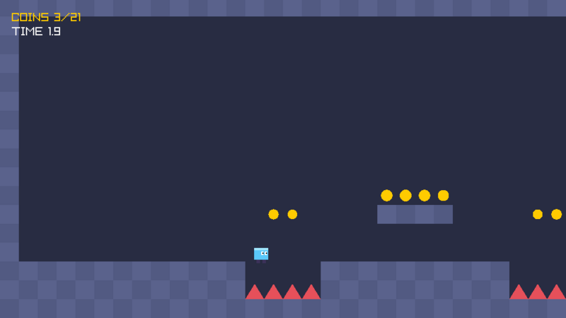
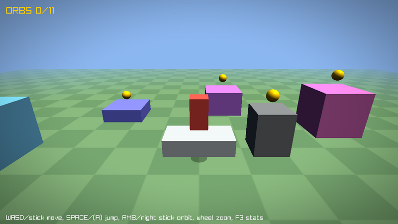

# raylib C++ game layer: `raylib.hpp`

[`src/raylib.hpp`](../../src/raylib.hpp) is an optional, header-only **C++17** layer on top of the raylib C API. It adds the building blocks that 2D and 3D games usually end up writing by hand, with no new dependencies and no extra library to build.

- **It's opt-in.** It includes `raylib.h` and `raymath.h`, so the whole C API (and raymath's C++ operators) stays available.
- **It interoperates.** Every wrapper converts implicitly to its raylib type, so `DrawTexture(myRlTexture, ...)` just works.
- **It's zero-cost where it matters.** Handles are a struct plus a `bool`. There's no virtual dispatch outside `rl::Scene`, and nothing allocates per frame.

```cpp
#include "raylib.hpp"

int main()
{
    rl::Window window(1280, 720, "my game");            // CloseWindow() on scope exit
    rl::Texture hero{ LoadTexture("hero.png") };        // UnloadTexture() on scope exit

    while (!window.ShouldClose())
    {
        rl::ScopedDrawing frame;                        // BeginDrawing() ... EndDrawing()
        ClearBackground(RAYWHITE);
        DrawTexture(hero, 10, 10, WHITE);               // Converts to Texture2D
    }
}
```

## Examples

| example | image | shows |
|---------|-------|-------|
| [cpp_platformer_2d](cpp_platformer_2d.cpp) |  | Scene stack (title, game, pause overlay), 120 Hz physics with interpolation, input actions with gamepad support, coyote time and jump buffering, camera follow with deadzone and bounds, trauma screen shake, procedural sprite animation, tweens |
| [cpp_third_person_3d](cpp_third_person_3d.cpp) |  | Explicit fixed-step loop, orbit camera, camera-relative movement, quaternion rotations through `Transform`, transform interpolation, lit and fog shader, post-processing pass, all resources RAII-managed |

Controls are listed at the top of each source file. Both examples use only generated assets, so they have no resource folders.

## What's inside

| Feature | Types / functions | Why it matters for games |
|---------|-------------------|--------------------------|
| RAII resources | `rl::Texture`, `rl::RenderTexture`, `rl::Image`, `rl::Font`, `rl::Shader`, `rl::Model`, `rl::Mesh`, `rl::Material`, `rl::Sound`, `rl::Music`, `rl::Wave`, `rl::AudioStream`, `rl::ModelAnimations` | No leaks on early returns, and resources can live in `std::vector`, `std::unordered_map` and class members. Handles are move-only, so you can't double-free. |
| Device lifetime | `rl::Window`, `rl::AudioDevice` | Destruction order handles shutdown for you. |
| Scoped render states | `rl::ScopedDrawing`, `ScopedMode2D`, `ScopedMode3D`, `ScopedTextureMode`, `ScopedShaderMode`, `ScopedBlendMode`, `ScopedScissorMode` | You can't forget an `End*()` call, and nesting is visible in the code structure. |
| Fixed timestep | `rl::FixedTimestep` (`Advance`, `Step`, `Dt`, `Alpha`) | Deterministic physics independent of framerate, with a "spiral of death" clamp. `Alpha()` drives render interpolation. |
| Interpolation | `rl::Lerp` for `float`, `Vector2`, `Vector3`, `Color`, `Transform` (slerp); `rl::SmoothFactor` | Smooth rendering between physics steps and framerate-independent smoothing. |
| Input mapping | `rl::InputMap` (`BindKey`, `BindGamepadButton`, `BindAxisKeys`, `BindAxisGamepad`, `GetAxis2D`...) | Gameplay code asks for `"jump"`, not `KEY_SPACE`. Keyboard, mouse and gamepad are unified, with deadzone rescaling and diagonal normalization. |
| Asset caching | `rl::AssetCache<T>`, `rl::TextureCache`, `ModelCache`, `SoundCache`... | Each file loads once, references are shared, and you can plug in a custom loader (packs, generated assets). |
| Scenes | `rl::Scene`, `rl::SceneStack` (`Push`, `Pop`, `Replace`, overlays), `rl::Run()` | Title, gameplay, pause and loading screens. Changes are deferred, so it's safe to switch scenes from inside a scene. |
| Gameplay timing | `rl::Timer`, `rl::Tween<T>`, `rl::ease::*` | Cooldowns, spawners, UI juice and pickups, with 17 easing curves. |
| Cameras | `rl::CameraFollow2D`, `rl::ScreenShake` (2D and 3D), `rl::OrbitCamera` | Smooth bounded follow, trauma-based shake and a third-person orbit with camera-relative axes. |
| 2D sprites | `rl::SpriteSheet`, `rl::SpriteClip`, `rl::SpriteAnimator`, `rl::DrawSprite` | Grid sprite sheets, clips and horizontal flipping. |
| 3D transforms | `rl::MakeTransform`, `rl::TransformToMatrix`, `rl::DrawModelTransform` | Quaternion rotations without converting to axis/angle for `DrawModelEx()`. |
| Diagnostics | `rl::FrameStats` | Rolling average, min and max frame times with an on-screen graph that flags hitches. |

## Building

**CMake (this repository):** with `-DBUILD_EXAMPLES=ON`, the C++ examples are built next to the C ones (`cpp_platformer_2d`, `cpp_third_person_3d`).

**CMake (your project):** `raylib.hpp` is installed alongside `raylib.h`, so nothing changes except the language standard:

```cmake
find_package(raylib REQUIRED)   # or FetchContent / add_subdirectory
add_executable(game main.cpp)
target_compile_features(game PRIVATE cxx_std_17)
target_link_libraries(game raylib)
```

**Command line (Linux):**

```bash
g++ -std=c++17 -O2 main.cpp -I path/to/raylib/src path/to/libraylib.a -lGL -lm -lpthread -ldl -lrt -lX11
```

## Guidelines

- **Declare `rl::Window` first.** C++ destroys objects in reverse order, so GPU and audio resources declared after the window get unloaded while the context is still alive.
- **Name your scoped objects.** `rl::ScopedDrawing frame;` lasts until the end of the block, but an unnamed temporary `rl::ScopedDrawing{};` ends immediately (constructors are `[[nodiscard]]` to help catch this).
- **Sample "pressed" input per frame, consume it in fixed steps.** `IsKeyPressed()` is true for one rendered frame, which can contain zero or several fixed steps. Both examples store presses in a buffer timer (`jumpBuffer.Start()`) that the fixed step consumes.
- **Models don't own their shaders and textures.** `UnloadModel()` frees meshes and material maps but not the assigned shaders and textures, by design, so they can be shared. Keep those in their own `rl::Shader` and `rl::Texture` handles.
- **Use `Release()` to drop down to C.** It hands ownership back to you as the plain raylib struct.
